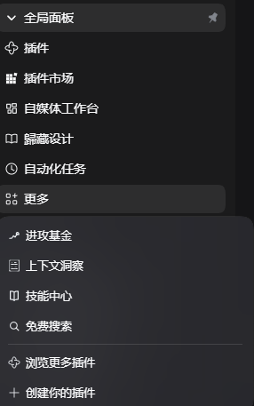
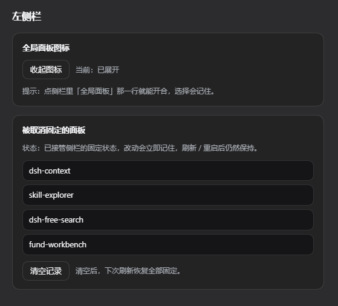

# dsh-sidebar-kit · 左侧栏管家

> 左侧栏的两件事，一个插件管完：**图标折叠** + **固定选择记住**。

<p align="center">
  
</p>

<p align="center">
  <sub>侧栏顶部多了一行「全局面板 ▾」——点整行就收起 / 展开其余图标。<br>
  图里「更多」菜单中的「进攻基金 / 上下文洞察 / 技能中心 / 免费搜索」就是被取消固定的面板。</sub>
</p>

<p align="center">
  
</p>

<p align="center">
  <sub>设置 → 左侧栏：折叠开关、当前状态、以及记住的面板清单（含「已接管」实时状态）。</sub>
</p>

这是 `dsh-sidebar-fold`（侧栏整理）和 `dsh-pin-persist`（侧栏固定）的合并版。
两者都在改左侧栏的同一块地方，分成两个插件维护既啰嗦、又要小心它们互相踩。
合并之后：一个包、一个设置页、一份状态。

## 它做两件事

### 1. 折叠：把图标收成一行

侧栏顶部那排全局面板图标，会随插件越装越多而越拉越长。本插件在最前面加一行
「全局面板 ▾」：点它，其余图标收起来；再点，展开。

- **点整行**就开合，不用瞄准那个小箭头。
- 折叠是**纯 CSS**（`html[data-sbk-fold="1"]` + `:has()`），所以**你以后新装的插件，
  它的图标也会自动落进折叠范围**，不需要逐个登记 id。
- 别的插件注册的图标只做视觉折叠：不改它们的注册、不改顺序、不替换任何槽位。

### 2. 固定：让「取消固定」活得久一点

DSH 官方侧栏把「哪些全局面板被取消固定了」**只存在内存里**。官方源码写得很直白：

```js
// panel-pins.ts —— 每次 apply 重建，没有任何存储后端
function createPanelPins() {
  const store = createSnapshotStore({ unpinned: NO_PANELS })
  ...
}
```

所以刷新页面、重启软件，被取消固定的图标**全部回到列表**。本插件补上这一层：
你的选择会被记住，刷新、重启都还在，**除非你自己把它固定回来**。

## 怎么做到的 —— 不碰官方代码

官方侧栏并没有把这份状态藏起来：它在 `sidebar` 槽位的注册项里，通过 `inject`
注入面把 `setPinned` 和 `hooks.entryPins`（一个活快照）交给了自己的组件。而
`ctx.slots.entriesOfSlot()` 是**公开 API**。

所以本插件「借用」：

1. `ctx.slots.entriesOfSlot('sidebar')` 找到侧栏那一行注册项；
2. 调它自己的 `inject()`，拿到**同一个** `panelPins` 单例 —— 不是复制品，就是你点
   图钉时操作的那一份；
3. 挂载时把 localStorage 里记着的 id 逐个 `setPinned(id, false)` **回放**进去；
4. 之后订阅那个快照，每次变化写回 localStorage。

**回放必须早于订阅**：否则挂载瞬间那个空的初始快照会立刻把保存的清单覆盖成 `[]`。
代码里对此有注释，`test.mjs` 有针对这一条的测试。

侧栏重建（插件重载）时会在 `slots/changed` 上重新借用，不会记着一个已经没人用的旧 store。

## 装

```sh
dsh plugin --profile desktop add "github:XiaoSHang05/dsh-sidebar-kit"
```

装完**重启 DSH**，然后刷新页面。浏览器侧的代码在进程重启时才会重新读取。

## 从旧插件迁移

如果你之前装过 `dsh-sidebar-fold` 或 `dsh-pin-persist`，本插件**首次运行会自动继承**
它们的设置，并立刻写到自己的键上（所以旧插件卸载后，选择不会跟着失效）：

| 旧键 | 新键 |
|---|---|
| `dsh-sidebar-fold:collapsed` | `dsh-sidebar-kit:folded` |
| `dsh-pin-persist:unpinned` | `dsh-sidebar-kit:unpinned` |

装本插件之后，请把旧的两个插件停用/卸载 —— 否则两者都会去改同一份 pin store。

## 设置

**设置 → 左侧栏**（见上面第二张图）：

- 折叠的开合开关与当前状态；
- 当前记着哪些面板被取消固定（含「已接管 / 未接管」的实时状态）；
- 一键清空记录（清空后，下次刷新恢复全部固定）。

## 已知边界

- 记录的是**面板 id**，不是列表位置。某个面板以后被卸载了，它的 id 留在记录里也
  不影响别的面板（`setPinned` 对不存在的 id 是无害的空操作）。
- 每个浏览器 / 每个 profile 各记各的（存在 `localStorage` 里），不跨设备同步。
- 侧栏「更多」菜单里把面板**固定回去**时，官方 store 会同步更新，本插件也一并记录 ——
  两个方向都跟得上。
- 安全底线：任何异常都吞掉。最坏结果只是「没折叠」或「没持久化」，回到官方原生
  行为，绝不会让侧栏渲染失败。卸载即完全复原。

## 开发

```sh
node --check client.js   # 语法检查（无构建步骤，client.js 就是产物）
node test.mjs            # 逻辑测试：迁移、回放顺序、幂等
```

插件的全部逻辑在浏览器侧 `client.js`；`index.js` 的宿主半部是空的。

## 许可

MIT
